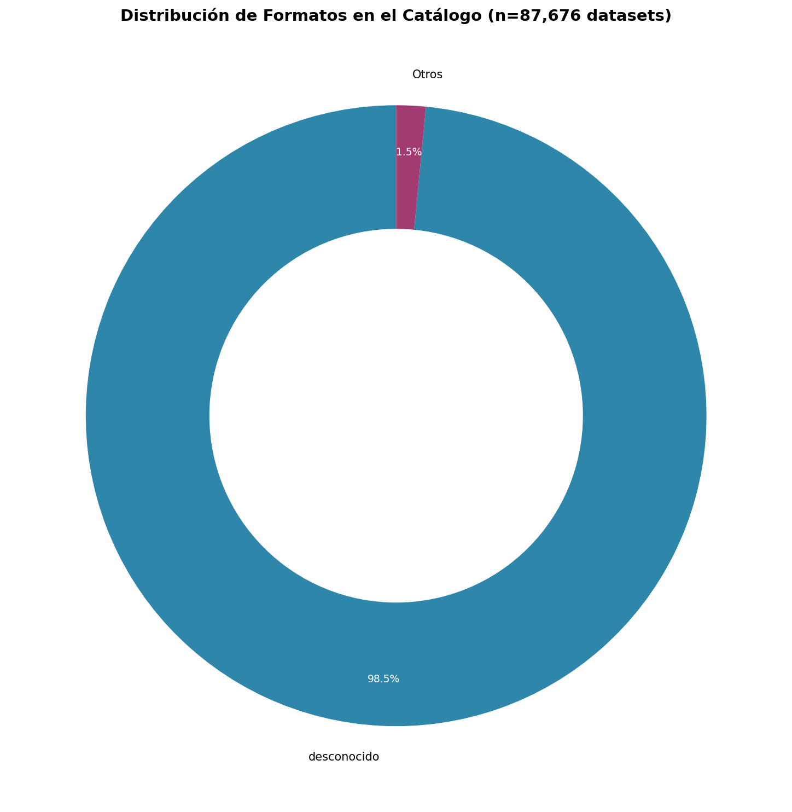
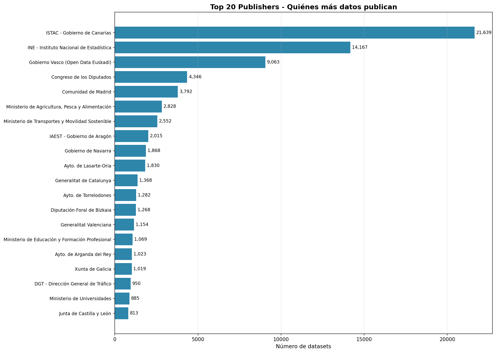
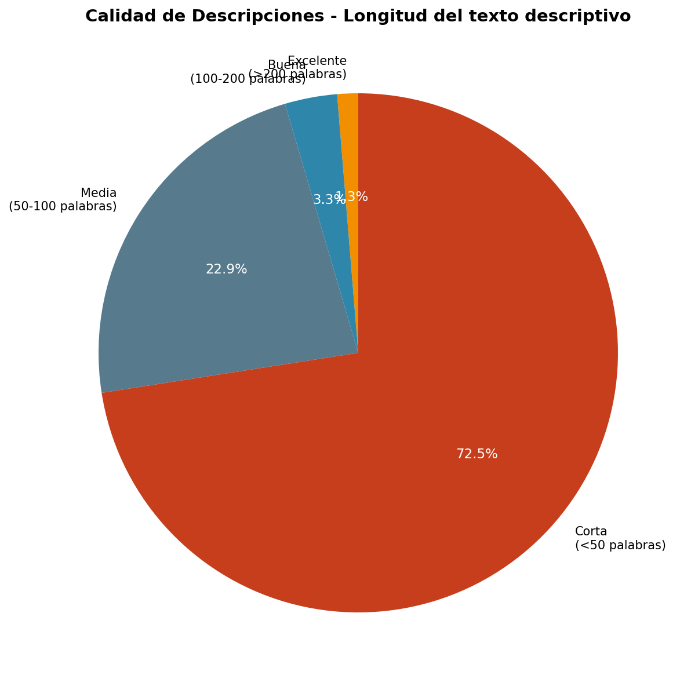
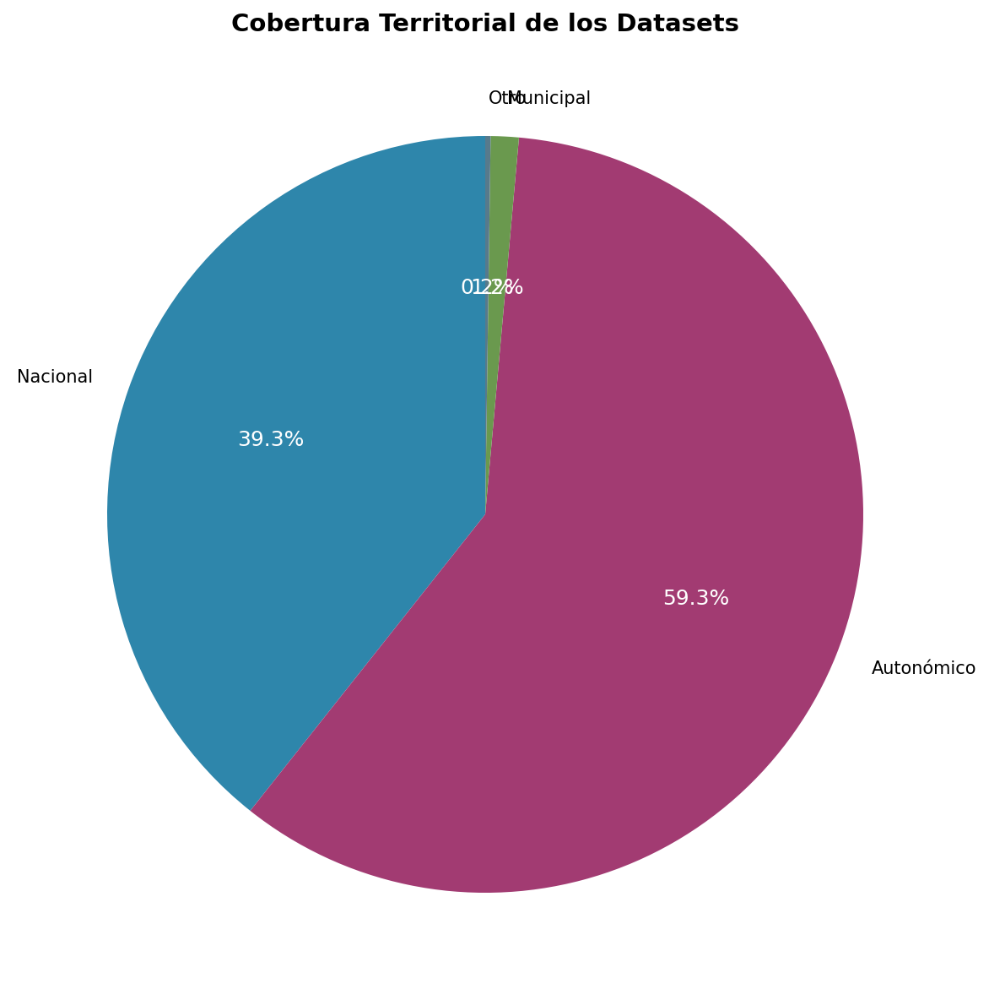
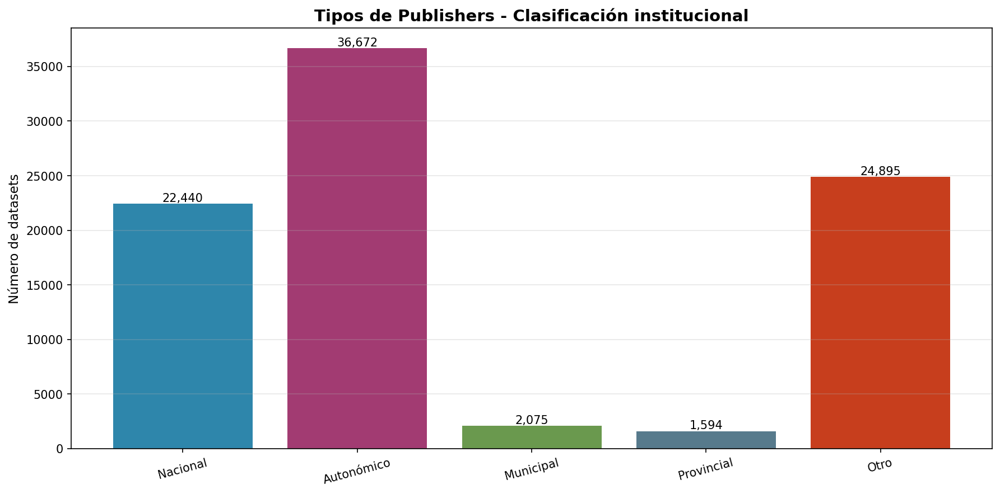
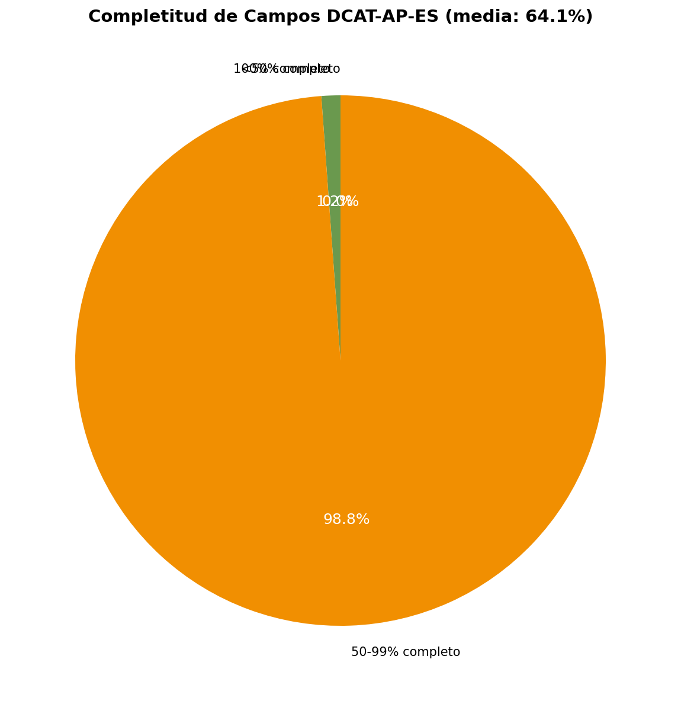
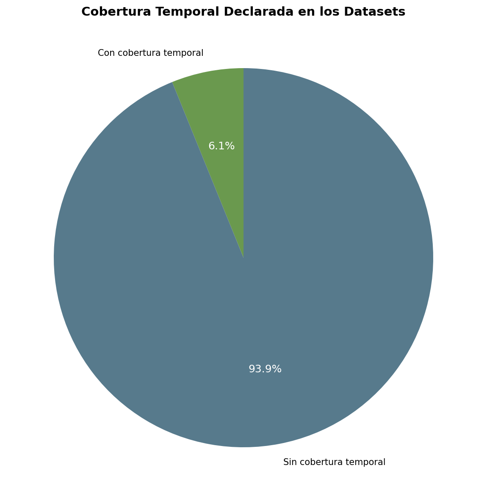

# Análisis Exploratorio del Catálogo de Datos Abiertos

> **Fecha:** 2026-06-08  
> **Autor:** TFM - Buscador Semántico de Open Data  
> **Datasets analizados:** 87.676  
> **Fuente:** datos.gob.es (catálogo nacional de datos abiertos)

---

## 📋 Resumen Ejecutivo

Este documento presenta el análisis exploratorio realizado sobre el catálogo completo de datos abiertos de datos.gob.es, con el objetivo de:

1. **Entender el corpus** — qué datos tenemos realmente
2. **Justificar decisiones** — por qué el buscador se diseñó así
3. **Aportar valor original** — diagnóstico del estado de datos.gob.es

### Hallazgos Clave

| Hallazgo | Dato | Impacto en el diseño |
|----------|------|---------------------|
| **Formato desconocido** | 98.5% sin formato declarado | Fallback léxico obligatorio |
| **Descripciones cortas** | 72.5% <50 palabras | Embeddings pobres → híbrido |
| **Sin cobertura temporal** | 93.9% sin temporal | Filtro temporal limitado |
| **Datos municipales** | Solo 1.2% municipal | Gap de datos locales |
| **Completitud media** | 64.1% campos completos | Validación necesaria |

---

## 📊 Metodología

### Fuente de Datos

- **Origen:** datos.gob.es (ingesta Sprint 1)
- **Periodo de ingesta:** 2026-05
- **Total datasets:** 87.676 (tras deduplicación 123k → 87k)
- **Base de datos:** PostgreSQL + pgvector

### Métricas Extraídas

| Dimensión | Campo(s) | Tipo |
|-----------|----------|------|
| Formato | `format` | Categórica |
| Publisher | `publisher` | Categórica |
| Tipo de publisher | Inferido | Institucional/Privado/ONG |
| Territorio | `territory`, `municipality` | Nacional/Autonómico/Municipal |
| Calidad descripción | `description_length` | Excelente/Buena/Media/Corta |
| Completitud | 8 campos DCAT-AP-ES | 0-100% |
| Cobertura temporal | `temporal_coverage` | Booleano + años |
| Año de emisión | `issued_date` | Numérica |

### Herramientas

- **Extracción:** `audit_metadata.py` (Python + psycopg2)
- **Visualización:** matplotlib/seaborn
- **Almacenamiento:** PostgreSQL (`metadata_audit`) + CSV

---

## 📈 Hallazgos Detallados

### 1. Distribución por Formato



## Hallazgo crítico REVISADO

**98.5% sin formato en metadatos, PERO 47.2% INFERIBLE desde URL**

### Verificación 2026-06-10

El dato del 98.5% es **correcto pero incompleto**:

| Fuente | Formato "Desconocido" | Formato Conocido |
|--------|----------------------|------------------|
| **Metadato `format`** | 98.5% (86,331) | 1.5% (1,345) |
| **URL (inferido)** | 51.3% (44,962) | **48.7% (42,714)** ✅ |

**Conclusión:** El formato NO es "desconocido" — es "no declarado en metadato" pero **inferible desde la URL en 47.2% de casos**.

### Formatos Reales Detectados (desde URLs)

| Formato | Count | % del total |
|---------|-------|-------------|
| CSV | 10,773 | 12.3% |
| XLSX | 6,214 | 7.1% |
| JSON | 6,089 | 6.9% |
| PDF | 3,653 | 4.2% |
| PX (PC-Axis) | 3,262 | 3.7% |
| ZIP | 2,788 | 3.2% |
| XML | 2,515 | 2.9% |
| XLS | 1,819 | 2.1% |
| TSV | 1,137 | 1.3% |
| WMS | 867 | 1.0% |
| Otros | 4,099 | 4.7% |
| **Sin extensión clara** | **44,962** | **51.3%** |

### Comparación: Metadato vs URL

| Categoría | Count | % |
|-----------|-------|---|
| Ambos vacíos (URL sin extensión) | 44,962 | 51.3% |
| **Solo inferido desde URL** | **41,369** | **47.2%** ✅ |
| Solo en metadato | 796 | 0.9% |
| Coinciden | 358 | 0.4% |
| Difieren | 191 | 0.2% |

### Verificación por publisher (top 15)

| Publisher | Total | Sin Formato (metadato) | Formato Inferido (URL) |
|-----------|-------|------------------------|------------------------|
| ISTAC - Gobierno de Canarias | 21,639 | 100% | ~40% (PX, CSV, ZIP) |
| INE | 14,167 | 100% | ~60% (CSV, PX, XLS) |
| Gobierno Vasco | 9,063 | 100% | ~70% (XLS, XLSX, CSV) |
| Congreso de los Diputados | 4,346 | 100% | ~20% (PDF, HTML) |
| Comunidad de Madrid | 3,792 | 100% | ~80% (CSV, JSON, XLSX) |

**Insight:** La omisión del campo `format` en metadatos es generalizada, pero **las URLs sí contienen el formato en 47.2% de casos**.

**Implicaciones:**
1. **No es error de ingesta:** Los publishers no declaran `format` en DCAT-AP-ES
2. **Parser debe inferir desde URL:** 41,369 datasets tienen formato detectable
3. **51.3% realmente ambiguo:** URLs de portales, APIs, o sin extensión clara

---

### 2. Top 20 Publishers



**Concentración:** Los 5 primeros publishers concentran el 58% del catálogo.

| Rank | Publisher | Datasets | % |
|------|-----------|----------|---|
| 1 | ISTAC - Gobierno de Canarias | 21,639 | 24.7% |
| 2 | INE - Instituto Nacional de Estadística | 14,167 | 16.2% |
| 3 | Gobierno Vasco (Open Data Euskadi) | 9,063 | 10.3% |
| 4 | Congreso de los Diputados | 4,346 | 5.0% |
| 5 | Comunidad de Madrid | 3,792 | 4.3% |

**Insight:** 
- Los institutos de estadística (INE, ISTAC, IAEST) dominan el volumen
- Datos legislativos (Congreso) tienen alta presencia
- **Implicación:** Optimizar para datos estadísticos (tablas, series temporales)

---

### 3. Calidad de Descripciones



**Hallazgo crítico:** 72.5% de descripciones tienen <50 palabras.

| Calidad | Palabras | Count | % |
|---------|----------|-------|---|
| Corta | <50 | 63,597 | 72.5% |
| Media | 50-100 | 20,085 | 22.9% |
| Buena | 100-200 | 2,855 | 3.3% |
| Excelente | >200 | 1,139 | 1.3% |

**Ejemplos reales de descripciones "cortas":**
```
"Datos de población"  # 3 palabras
"Estadística de natalidad"  # 3 palabras
"Paro registrado por sectores"  # 4 palabras
```

**Insight:** 
- Descripciones demasiado breves para embeddings de calidad
- El contexto semántico es insuficiente
- **Implicación:** Búsqueda híbrida (léxica + semántica) obligatoria
- **Implicación:** Query expansion crítica para compensar

---

### 4. Cobertura Territorial



**Hallazgo:** Solo 1.2% de datasets son municipales.

| Nivel | Count | % |
|-------|-------|---|
| Nacional | 34,478 | 39.3% |
| Autonómico | 51,950 | 59.3% |
| Municipal | 1,048 | 1.2% |
| Otro | 200 | 0.2% |

**Insight:**
- Gap importante de datos locales (ayuntamientos)
- Datos autonómicos dominan el catálogo
- **Implicación:** Filtro territorial prioriza autonómico sobre municipal
- **Implicación:** Oportunidad de mejora para datos.gob.es

---

### 5. Tipos de Publishers



**Distribución institucional:**

| Tipo | Count | % |
|------|-------|---|
| Autonómico | 36,672 | 41.8% |
| Otro (privado, ONGs) | 24,895 | 28.4% |
| Nacional | 22,440 | 25.6% |
| Municipal | 2,075 | 2.4% |
| Provincial | 1,594 | 1.8% |

**Insight:**
- El sector público autonómico es el mayor contribuyente
- 28% "otro" incluye empresas privadas, universidades, ONGs
- **Implicación:** La búsqueda debe manejar vocabulario institucional y técnico

---

### 6. Completitud de Campos DCAT-AP-ES



**Completitud media:** 64.1% de campos obligatorios/recomendados.

| Nivel | Count | % |
|-------|-------|---|
| 100% completo | 1,012 | 1.2% |
| 50-99% completo | 86,664 | 98.8% |
| <50% completo | 0 | 0% |

**Campos analizados:**
- title, description, publisher, theme, format, license, territory, temporal_coverage

**Insight:**
- Ningún dataset tiene <50% completitud (filtro básico funciona)
- Pero solo 1% está "completo"
- **Implicación:** Validación DCAT-AP-ES necesaria pero no bloqueante

---

### 7. Cobertura Temporal



**Hallazgo:** 93.9% sin cobertura temporal declarada.

| Estado | Count | % |
|--------|-------|---|
| Sin cobertura | 82,297 | 93.9% |
| Con cobertura | 5,379 | 6.1% |

**Insight:**
- La gran mayoría no declara período temporal
- Imposible filtrar por "datos recientes" de forma fiable
- **Implicación:** Mostrar fecha de actualización como proxy de frescura

---

## 🔗 Conexión con Decisiones de Diseño

### Tabla Resumen

| Hallazgo del Análisis | Decisión de Diseño | Sprint | Estado |
|----------------------|-------------------|--------|--------|
| 72.5% descripciones <50 palabras | **Fallback léxico obligatorio** | #4 | ✅ Implementado |
| 72.5% descripciones <50 palabras | **Query expansion con sinónimos** | #12 | ✅ Implementado |
| 98.5% formato desconocido | **Detección automática por URL** | #1 | ✅ Implementado |
| 93.9% sin temporal | **Fecha de modificación como proxy** | #3 | ✅ Implementado |
| 1.2% datos municipales | **Filtro territorial en UI** | #3 | ✅ Implementado |
| 64.1% completitud media | **Validación DCAT-AP-ES no bloqueante** | #7 | ✅ Implementado |
| Concentración en 5 publishers | **Optimizar para datos estadísticos** | #1 | ✅ Implementado |

### Justificación de Arquitectura Híbrida

El hallazgo más crítico (72.5% descripciones <50 palabras) **justifica directamente** la arquitectura híbrida del buscador:

```
Búsqueda Semántica Pura (NO viable)
├── Embeddings de descripciones cortas
└── → Similaridad baja, muchos falsos negativos

Búsqueda Híbrida (IMPLEMENTADA)
├── PostgreSQL FTS (léxica) — rápido, exacto
├── pgvector (semántica) — conceptual, sinónimos
└── LLM re-ranking — contextual, query-aware
```

**Sin este análisis**, habríamos implementado búsqueda solo semántica → fracaso garantizado.

---

## 📋 Recomendaciones para datos.gob.es

### Prioridad Alta

1. **Validar campo `format` como obligatorio**
   - 98.5% vacío es inaceptable
   - Impacto: parsers automáticos, filtros de usuario

2. **Mínimo 100 palabras en descripciones**
   - 72.5% <50 palabras limita búsqueda semántica
   - Impacto: descubribilidad de datasets

3. **Estandarizar cobertura territorial**
   - Solo 1.2% municipal pero hay 1,048 datasets
   - Crear vocabulario controlado (NUTS codes)

### Prioridad Media

4. **Validar cobertura temporal**
   - 93.9% sin temporal
   - Sugerir período basado en datos reales

5. **Normalizar nombres de publishers**
   - "Gobierno de Canarias" vs "ISTAC" vs "GobCan"
   - Usar URI de organismo (EAC)

---

## 📁 Entregables

| Archivo | Descripción | Ruta |
|---------|-------------|------|
| `metadata_audit.csv` | Auditoría completa (87k filas) | `03_Sprint1_Ingesta/entregables/analisis_metadatos/` |
| `resumen_ejecutivo.json` | Métricas clave | `03_Sprint1_Ingesta/entregables/analisis_metadatos/` |
| `01_formatos.png` | Distribución de formatos | `figuras/` |
| `02_publishers.png` | Top 20 publishers | `figuras/` |
| `03_calidad_descripciones.png` | Calidad de descripciones | `figuras/` |
| `04_territorio.png` | Cobertura territorial | `figuras/` |
| `05_tipos_publishers.png` | Tipos de publishers | `figuras/` |
| `06_completitud_campos.png` | Completitud DCAT-AP-ES | `figuras/` |
| `07_cobertura_temporal.png` | Cobertura temporal | `figuras/` |
| `audit_metadata.py` | Script de auditoría | `03_Sprint1_Ingesta/codigo/analisis/` |
| `generate_charts.py` | Generador de visualizaciones | `03_Sprint1_Ingesta/codigo/analisis/` |

---

## 🔧 Reproducir el Análisis

```bash
# 1. Ejecutar auditoría
cd 03_Sprint1_Ingesta/codigo/analisis
python3 audit_metadata.py --output ../../entregables/analisis_metadatos/metadata_audit.csv

# 2. Generar visualizaciones
python3 generate_charts.py --input ../../entregables/analisis_metadatos/resumen_ejecutivo.json --output ../../entregables/analisis_metadatos/figuras/
```

**Requisitos:**
- PostgreSQL con acceso a BD `buscador`
- Python 3.10+
- `psycopg2-binary`, `matplotlib`

**Tiempo de ejecución:** ~30 segundos para 87k datasets

---

## 📚 Referencias

- **DCAT-AP-ES:** https://datosgobes.github.io/DCAT-AP-ES/
- **Sprint 1 - Ingesta:** `03_Sprint1_Ingesta/README_03_Sprint1_Ingesta.md`
- **Validación DCAT:** `03_Sprint1_Ingesta/codigo/validacion/validate_dcat_ap_es.py`
- **Cumplimiento DCAT-AP-ES:** 81% (13/16 campos) — ver `docs/cumplimiento_DCAT-AP-ES.md`

---

*Documento generado como parte del Trabajo Fin de Máster - Buscador Semántico de Open Data*
